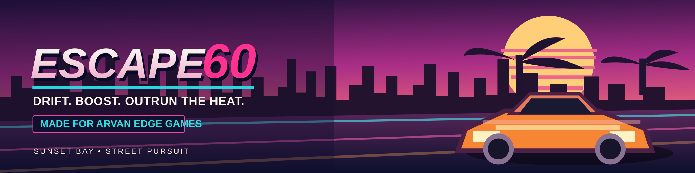
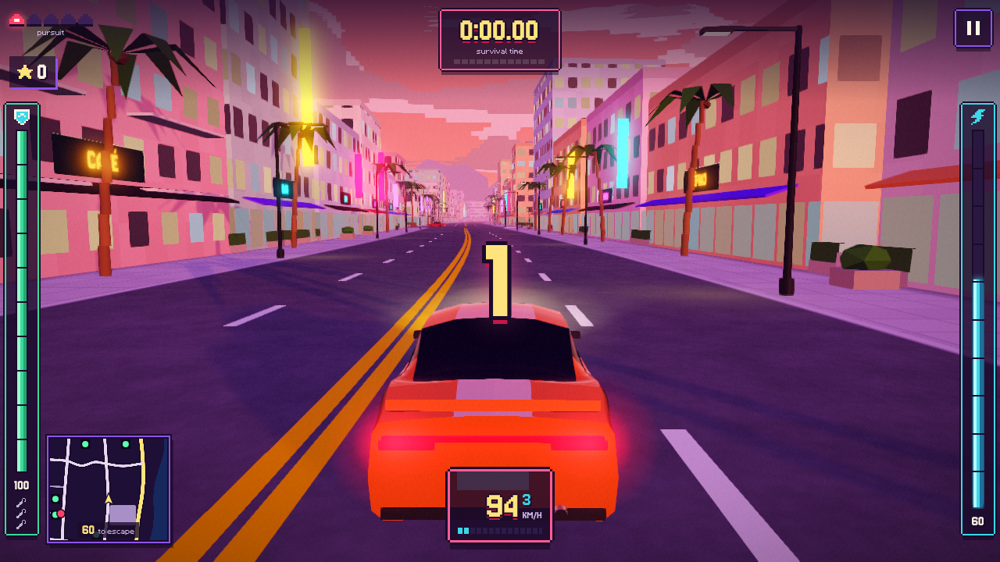
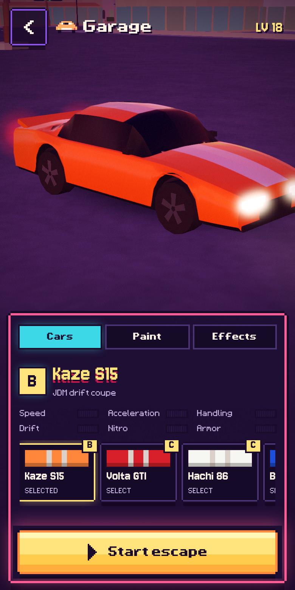
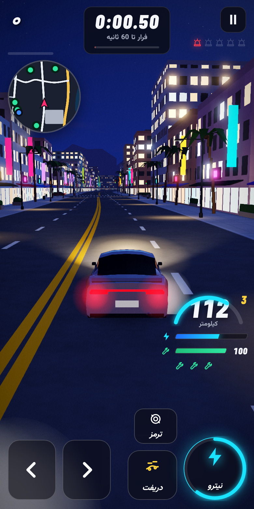
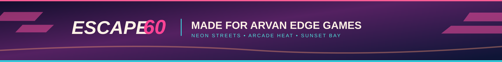

<div align="center">
  

  ## 🚔 فرار ۶۰ — یه دقیقه فرار، یه دنیا کری!

  وایب بازی‌های تعقیب‌وگریز و خیابون‌های نئونی، این بار توی یه بازی سه‌بعدی و پیکسلی. گاز بده، دریفت بکش، نیترو بزن و از دست پلیس در برو!

  **[🎮 بازی آنلاین](https://escape60.lavanai2525-3qem7.arvanedge.ir/)** · **[English README](README.md)** · **[☁️ مسابقه Edge Games](https://try.arvancloud.ir/edge-games/)**
</div>

> **توجه:** لینک آنلاین ممکنه هنوز نسخه قبلی بازی رو نشون بده. استقرار آخرین کد شاخه `main` باید دوباره تأیید بشه.

## 🌴 توی بازی چه خبره؟

- **۱۴ ماشین** با سرعت و هندلینگ مختلف؛ گاراژ، رنگ‌ها و افکت‌های متنوع.
- یه شهر بزرگ ساحلی به اسم **Sunset Bay** با بلوار ساحلی، خیابون‌های پرپیچ‌وخم، پل و اسکله.
- تعقیب پلیس، راه‌بندان، هلیکوپتر، نیترو، دریفت و ترمزدستی.
- **۶۰ ثانیه اول** رو دووم بیار و وارد تعقیب ادامه‌دار شو.
- چالش روزانه، مأموریت، پیشرفت، رتبه‌بندی و لینک رقابت با رفیقات.
- اجرای مرورگری روی موبایل و دسکتاپ، با رابط **فارسی و انگلیسی**.

## 📸 تصاویر واقعی بازی

<p align="center">
  
  
  
</p>

<sub>این تصاویر واقعیِ مرورگر هستند؛ پوسترهای تبلیغاتی و کانسپت‌آرت با اسکرین‌شات بازی فرق دارند.</sub>

## 🎮 کنترل‌ها

| حرکت | موبایل | کیبورد |
| --- | --- | --- |
| فرمان | نگه‌داشتن سمت چپ یا راست صفحه | `←` / `→` یا `A` / `D` |
| ترمز | BRAKE | `S` یا `↓` |
| دریفت | DRIFT | `Space` |
| نیترو | NITRO | `Shift` یا `W` |
| توقف | Pause | `P` |

## 🚀 اجرا روی کامپیوتر

برای اجرا Node.js نسخه ۲۰ به بالا لازم داری:

```bash
git clone https://github.com/ar-karkon/Escape60.git
cd Escape60
npm install
npm start
```

برو به **http://localhost:4173**. برای بررسی و ساخت خروجی:

```bash
npm run check
npm run build
```

## ⚙️ درباره پروژه

بازی با جاوااسکریپت و Three.js/WebGL ساخته شده. موتور رانندگی ۶۰ هرتزی و سیستم بازپخش سمت سرویس بازی برای ثبت امتیاز معتبر طراحی شده. مسیر اجرای آن روی Edge Computing آروان در [مستندات استقرار](docs/22_DEPLOYMENT.md) شرح داده شده.

برای وضعیت واقعی نسخه‌های منتشرشده به [وضعیت پروژه](docs/00_STATUS.md) و [تاریخچه تغییرات](docs/CHANGELOG.md) مراجعه کن.

این یک پروژه **مستقل ساخته‌شده برای مسابقه Edge Games آروان** است؛ استفاده از نام آروان به معنی حمایت یا تأیید رسمی این بازی نیست. ریپو عمومی است ولی فعلاً مجوز آزاد برای استفاده مجدد از کد و تصاویر اختصاصی ندارد. اعتبار موسیقی و افکت‌ها در [فهرست منابع صوتی](web/assets/audio/CREDITS.md) آمده.

<div align="center"></div>
