<div align="center">
  <a href="https://escape60.lavanai2525-3qem7.arvanedge.ir/">
    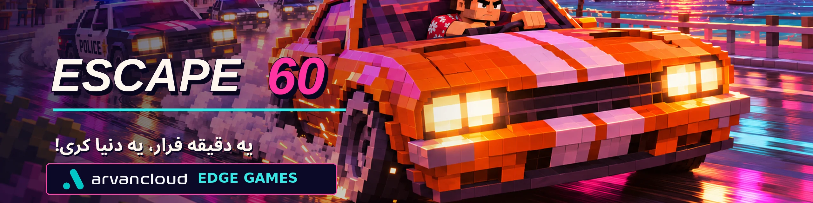
  </a>

  <br />

  [](https://escape60.lavanai2525-3qem7.arvanedge.ir/)
  [](README.fa.md)
  [](https://try.arvancloud.ir/edge-games/)

  ### 🌴 One city. No easy escape.

  **Drift. Boost. Outrun the heat.**

  A free, pixel-inspired **3D street-pursuit game** set in the tropical neon city of **Sunset Bay**. Survive your first **60 seconds**, then keep going — the chase only gets wilder.

  **[🎮 Play in your browser](https://escape60.lavanai2525-3qem7.arvanedge.ir/)** · **[🇮🇷 فارسی](README.fa.md)** · **[📖 Documentation](docs/README.md)**

</div>

> [!NOTE]
> **Live version:** The hosted game is a public preview and may still run an earlier release. The latest source on `main` is **not verified as redeployed**. Promotional art is distinct from actual gameplay screenshots.

## ✨ Why Escape 60?

| 🏎️ **Drive it your way** | 🚨 **Survive the pursuit** | 🌇 **Get lost in Sunset Bay** |
| :--- | :--- | :--- |
| **14 cars**, garage customisation, arcade drift, handbrake and nitro | Escalating police heat, roadblocks, takedowns and overtime chases | A coastal city with winding roads, landmarks, waterfront, canyon and neon nightscapes |

| 🎯 **Keep getting better** | 🎨 **Make it yours** | 📱 **Pick up and play** |
| :--- | :--- | :--- |
| Near misses, combos, XP, daily missions and shareable challenges | Vehicle paints, liveries, trails, smoke and nitro effects | Phone, desktop and gamepad; English and Persian |

## 📸 Actual gameplay

<p align="center">
  <a href="docs/screenshots/desktop-drive.png">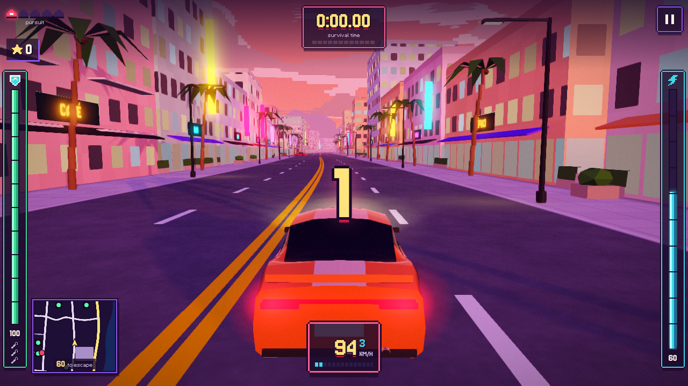</a>
  <a href="docs/screenshots/desktop-menu.png">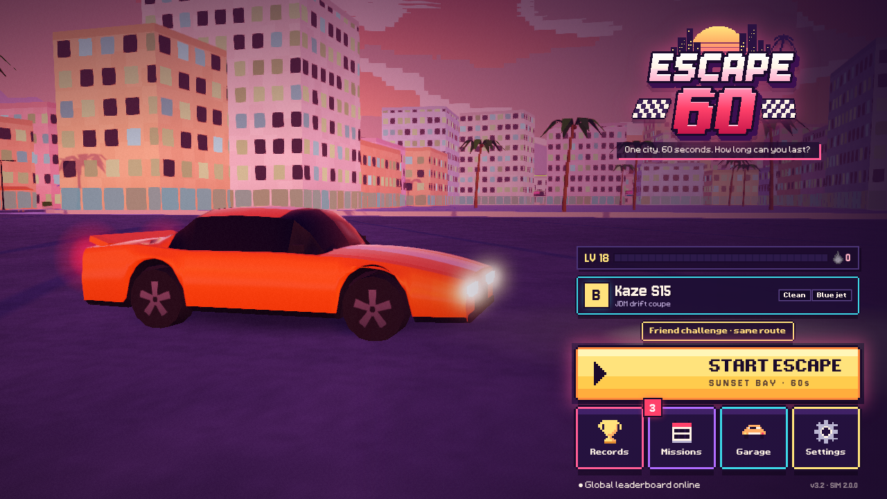</a>
  <br />
  <a href="docs/screenshots/drift.png">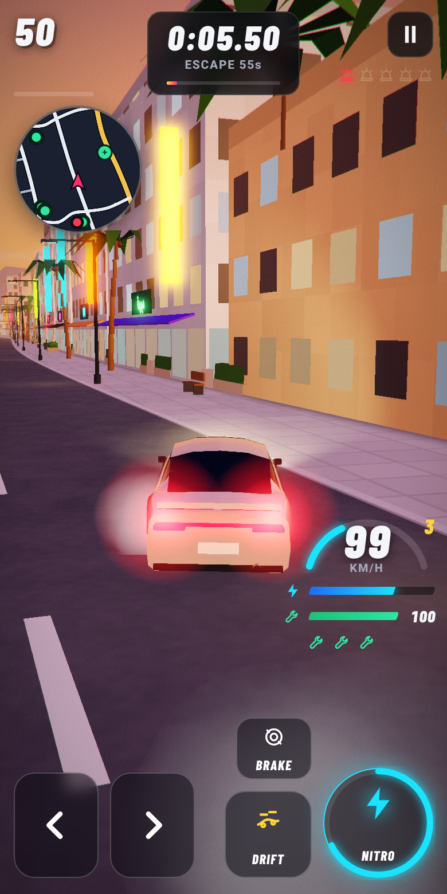</a>
  <a href="docs/screenshots/garage.png">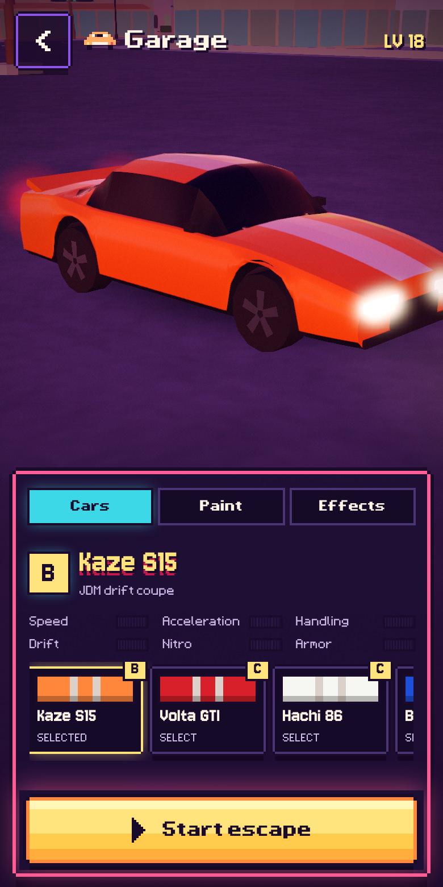</a>
  <a href="docs/screenshots/night.png">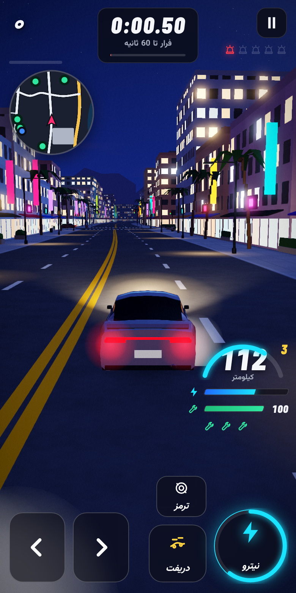</a>
  <br />
  <a href="docs/screenshots/intro.jpg">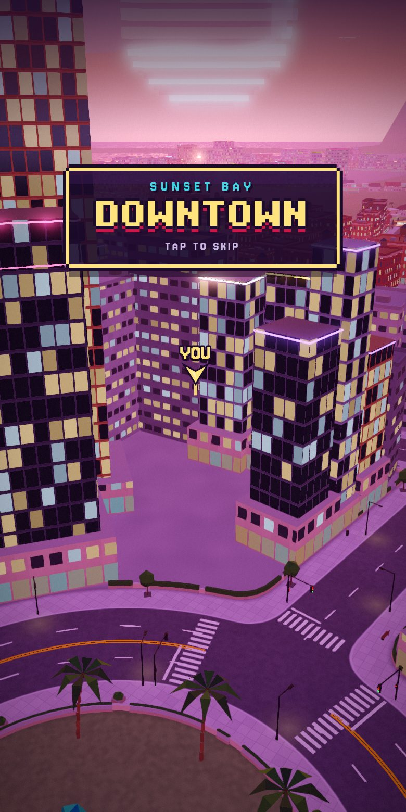</a>
  <a href="docs/screenshots/pursuit-tail.jpg">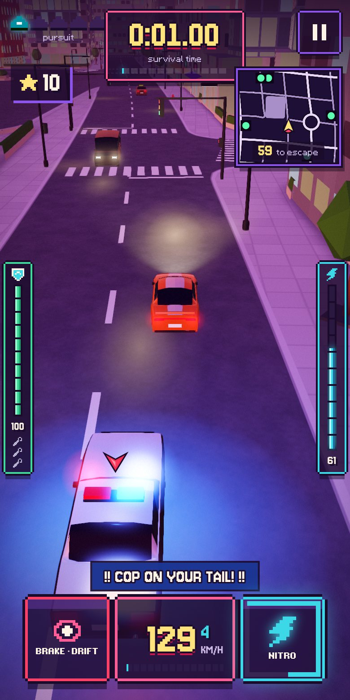</a>
  <a href="docs/screenshots/pursuit-radar.jpg">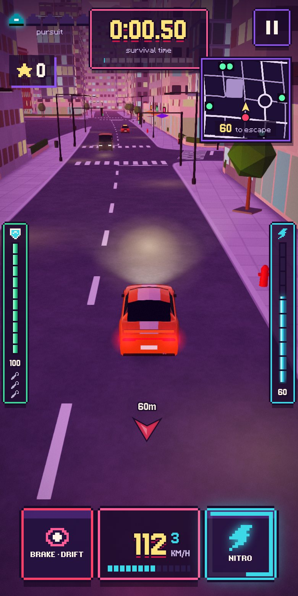</a>
  <a href="docs/screenshots/district-neon.jpg">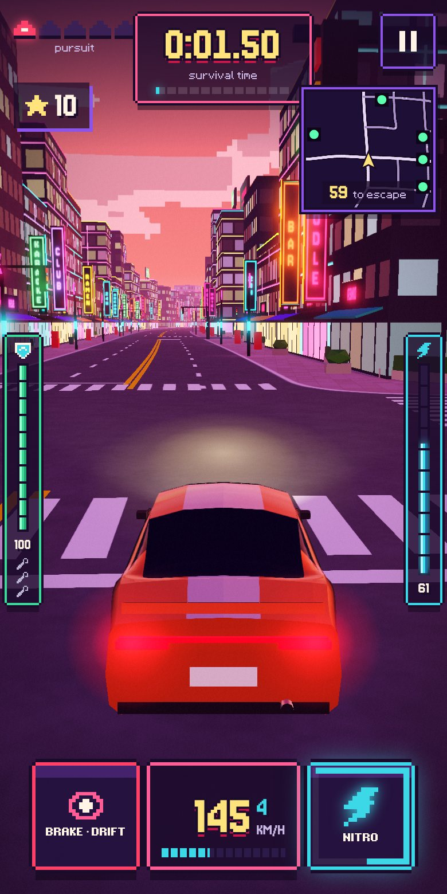</a>
  <br />
  <a href="docs/screenshots/district-oldtown.jpg">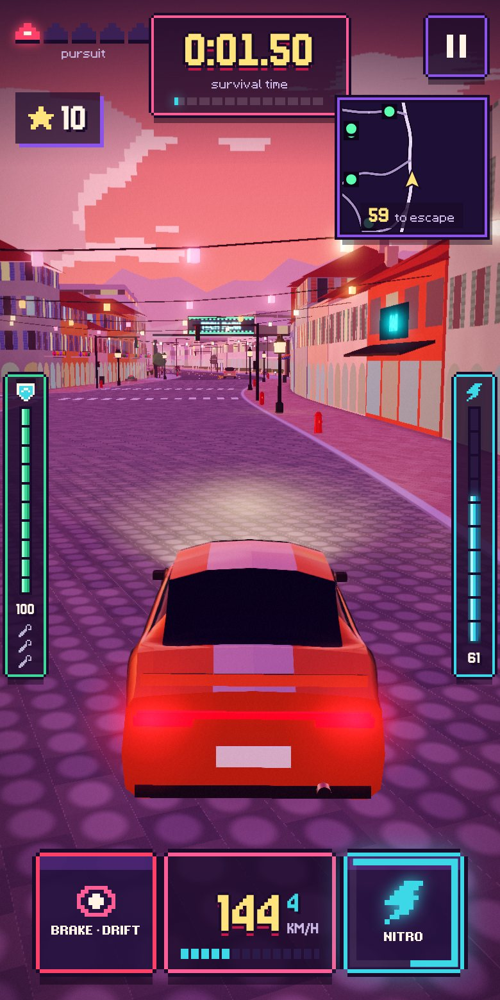</a>
  <a href="docs/screenshots/district-brickrow.jpg">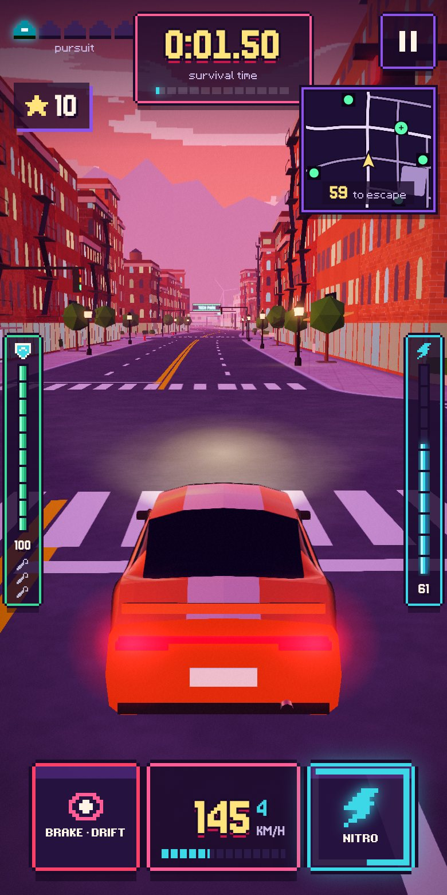</a>
  <a href="docs/screenshots/district-oceandrive.jpg">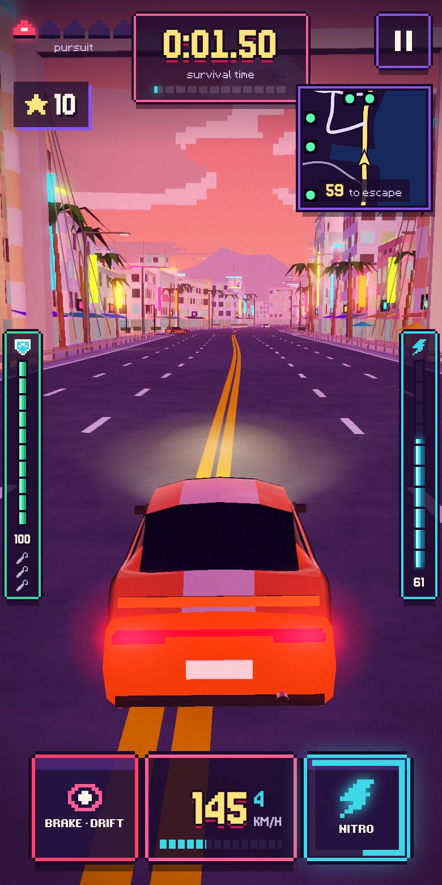</a>
  <a href="docs/screenshots/district-techpark.jpg">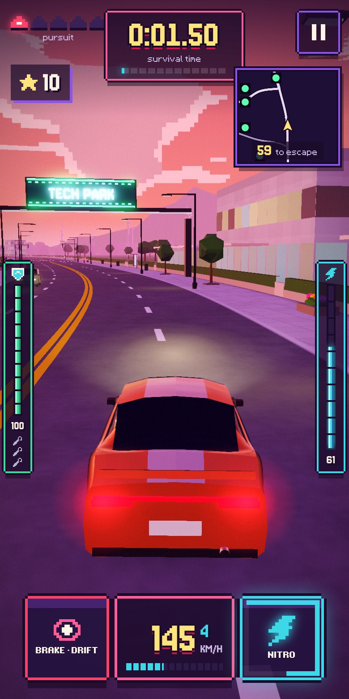</a>
  <br />
  <sub>Real captures from the browser. For the artistic vision, see the <a href="design/references/">concept references</a>.</sub>
</p>

## 🚀 Run locally

Requires Node.js 20+.

```bash
npm install            # dev tools only (esbuild); the game itself has no runtime dependencies
npm start              # http://localhost:4173 — game + local game service (leaderboard, replay)
npm test               # deterministic simulation + replay/anti-cheat tests
npm run check          # tests + syntax check of every module
npm run build          # deployable static site + edge worker in dist/
npm run edge:local     # run the built edge worker locally (http://localhost:4174, /edge dashboard)
npm run test:browser   # mobile smoke test incl. a real verified run (needs npm start)
npm run capture        # real screenshots into docs/screenshots (needs npm start)
npm run deploy         # release to Arvan from your computer (asks for the storage keys)
```

## 🎨 Game artwork

<div align="center">
  <a href="assets/branding/competition-cover.webp">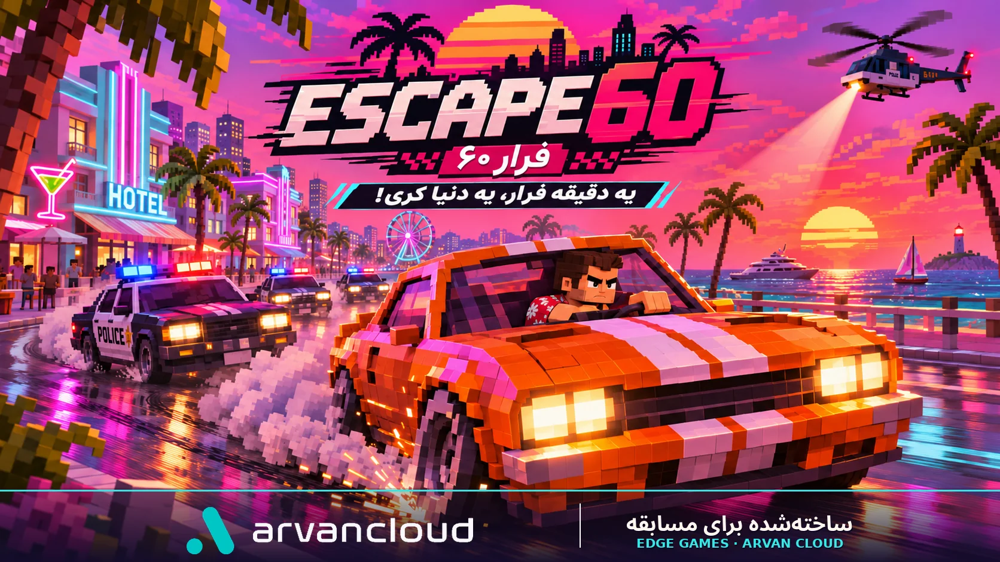</a>
  <br />
  <sub>Promotional illustration · separate from the actual game captures above.</sub>
  <br />
  <a href="assets/branding/game-icon.webp">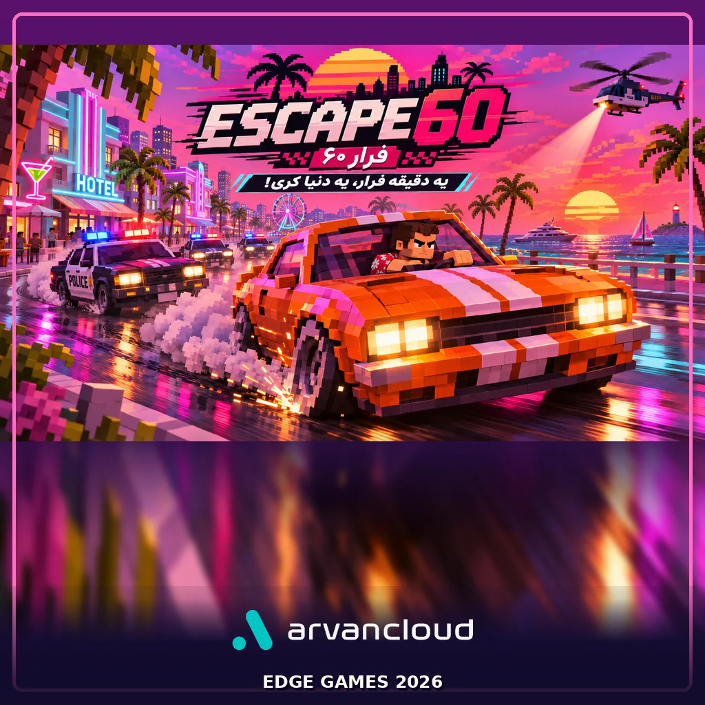</a>
</div>

## 🎮 Controls

| Action | Touchscreen | Keyboard | Gamepad |
| :--- | :--- | :--- | :--- |
| Steer | Hold left/right half of screen | `←` `→` / `A` `D` | Left stick |
| Brake | **BRAKE** | `↓` / `S` | LT / B |
| Drift / handbrake | **DRIFT** | `Space` | A |
| Nitro | **NITRO** | `Shift` / `↑` / `W` | RT / X |
| Pause | Pause button | `P` | Start |
| Retry | Retry button | `Enter` | Retry button |

<sub>Gamepad mapping may depend on device and browser.</sub>

## 🔥 Features — under the hood

- **Pursuit awareness**: off-screen police chevrons around your car with distance, siren light from the screen edge they come from, lock-on markers, a tail warning, a pursuit camera that frames the cop on your tail with you, and a slow-motion crane reveal when a cop first locks on (`web/src/ui/threats.js`, `web/src/render.js`).
- **Ten districts**: Downtown glass towers, Neon Mile, Brick Row, cobbled Old Town, Ocean Drive deco hotels, The Docks, Palm Heights villas, Tech Park, Red Canyon and Lakeside Park — each with its own facades, roofs, paving, lamps, trees, props, gates and landmarks. Every run opens with an aerial fly-in over the city to your car.
- **Sunset Bay map** (`web/src/map.js`): ~24 km of hand-authored roads (Catmull-Rom curves) — warped downtown grid with a roundabout and a plaza, Ocean Boulevard, a sweeping coastal highway with a bridge over the marina, a winding canyon with hairpins, a lake loop, Old Town lanes, the port road and five **pit stops**. Drivable space is a smooth signed-distance field (filleted junction corners), shared bit-for-bit by the game, the server replay, the renderer and the minimap.
- **Arcade drift physics** (`web/src/simulation.js`, SIM 2.2.0): every run starts at one of 50 start positions anywhere in the city (signed into the run ticket and replayed); automatic throttle, brake, handbrake slides, counter-steer, nitro, impact-scaled damage, a car that **limps and smokes when damaged**, **3 repairs** at pit stops, **explosion** at zero health, busted meter, takedowns (ram cops or make them crash), near misses, roadblock dodges, drift banking and a ×8 skill chain. Heat rises 1→5 over time with cruisers, interceptors, SUVs, roadblocks, spike strips and a helicopter. The 60 s mark is a milestone (+2,500, slow-motion celebration) — the run continues.
- **14 cars** (`web/src/cars.js`), each inspired by a classic road car shape (JDM coupes, hot hatches, touring sedans, muscle cars, a rear-engine classic, wedge supercars) with fictional names, no badges, their own stats (speed, acceleration, handling, drift, nitro, armour) and procedural lofted 3D bodies (`web/src/gfx/carmodel.js`). 16 paints and 5 liveries.
- **Selectable effects** in the garage: drift smoke (clean, comic, neon, rainbow, fire), nitro flame (blue jet, toxic, plasma, inferno), trails (light trails, neon tyres), combo bursts (graffiti, electric, minimal) and an accent colour.
- **Feel**: camera director with speed FOV, acceleration lag, brake dive, handbrake roll, drift flank view, nitro punch with zoom blur, chromatic aberration and graffiti wings, trauma-based impact shake, hit-stop and slow motion on big moments; skid marks, sparks, backfires, damage smoke and fire, explosions with debris and shockwave, knock-over street furniture (lamps, hydrants with water jets, benches, palms…).
- **Identity**: the original Sunset Bay soul — pixel logo, Rooyin Free + Jersey 10 pixel fonts, pixel icons and pixel-frame UI, magenta synthwave sunset with a striped retro sun and pixel clouds — merged with the new 3D world.
- **Look** (`web/src/gfx/`): stylised PBR city with procedural facades and lit windows, glossy clear-coat car paint with sky reflections, wet-road sheen at night, sea and lake water, palms, pines, cliffs, landmarks (fountain roundabout, ferris wheel pier, lighthouse, port cranes, bridge, hillside letters), three times of day (sunset, night, day), HDR bloom and filmic grading. Adaptive quality for weak phones.
- **Audio**: licensed music and SFX (CC0 / CC-BY, see `web/assets/audio/CREDITS.md`) plus synthesised explosion, nitro, repair, backfire, wind and gear-shifted engine pitch.
- **Progression & sharing**: XP and levels unlock cars, paints and effects; three daily missions and a day streak; daily shared route and friend-challenge links; share cards (story / post / wide) from a real in-engine frame with a QR code.
- **Daily city briefing, police radio and crew chief** (AIaaS): every day the city gets a theme, three contracts with rewards and its own police tactics — the simulation plays by them — plus bilingual police radio, a dispatcher call for each run and a crew-chief debrief after each verified run. How it works: [docs/TECHNOLOGY.md](docs/TECHNOLOGY.md).
- **Edge referee** (`edge/`, API 4.1.0 — see [the spec](docs/06_EDGE_SPEC.md)): the browser sends only its inputs. While you drive, the edge re-simulates every 5 s of them with the same 60 Hz simulation, refuses inputs that arrive faster than real time and answers with the authoritative score and your **live global rank**; the final verdict only replays the last seconds. Verified inputs come back as **ghost rivals** (the run just above your best, re-simulated bit-exactly in your game), verified runs get **PNG share cards drawn on the edge** and `/r/<id>` link previews, and every text file is negotiated as Brotli/gzip at the edge. Stateless: HMAC-signed tickets and checkpoints let any edge node answer any request. `/edge` is a live dashboard with telemetry from every edge isolate, a cheat lab and an edge benchmark. `web/src/dmath.js` keeps trigonometry identical across engines.

## 🗂️ Project layout

```text
web/index.html, web/style.css   UI shell (HUD, garage, results, dialogs)
web/src/main.js                 game flow, input (touch / keyboard / gamepad), HUD, events, share
web/src/simulation.js           deterministic 60 Hz rules (browser + server replay)
web/src/map.js                  Sunset Bay road graph, distance field, pit stops, zones
web/src/cars.js                 14 cars, police and traffic definitions
web/src/render.js               renderer: camera director, actors, lights, effects, post
web/src/gfx/                    materials, sky/TOD, city builder, props, car models, particles, effects, post
web/src/ui/                     minimap and icons
web/src/i18n.js                 English / Persian strings
web/src/meta.js                 XP, unlocks, garage choices, missions, challenge links
edge/                           game service (edge worker) + S3-compatible storage client
server/server.mjs               local dev server running the same game service
tests/                          simulation and API tests
scripts/                        build, checks, smoke test, screenshot capture, map preview
docs/                           design, decisions, deployment and status
```

## ☁️ Edge deployment

`npm run build` produces `dist/web/` (static site; works on any static host and on the edge proxy) and `dist/edge/worker.js` (API + static proxy). See `docs/22_DEPLOYMENT.md`. `npm run deploy` releases from your own computer without CI: it uploads only changed files, guides the one panel step (pasting the edge worker) and verifies the live URL, compression and the `/edge` dashboard. `npm run edge:local` runs the exact worker file locally first. The game service needs only an S3-compatible bucket (`S3_ACCESS_KEY`, `S3_SECRET_KEY`); without it the leaderboard falls back to memory. Replays run in chunks (`REPLAY_CHUNK`, default 300 ticks) to fit small per-request CPU budgets.

**Status:** see `docs/00_STATUS.md`. Real-device FPS and an audible mix check are still outstanding; the live deployment must be rebuilt and redeployed for this version.

## 🏁 Release status

| Area | Status |
| :--- | :--- |
| Driving, cars, garage and map | ✅ Implemented in source |
| Deterministic replay and ranking logic | ✅ Implemented; local tests available |
| Arvan Edge service | ✅ Prior live version tested; **latest build pending verification** |
| iOS Safari / real-device FPS / final audio mix | 🟡 Still needs hands-on QA |

Source-of-truth documents: **[Status](docs/00_STATUS.md)** · **[Deployment guide](docs/22_DEPLOYMENT.md)** · **[Changelog](docs/CHANGELOG.md)** · **[Documentation index](docs/README.md)**.

## 🤝 Contribute and connect

Want to improve the game? Open an [issue](https://github.com/ar-karkon/Escape60/issues) and see the [contributing guide](CONTRIBUTING.md). The repo is publicly readable, but it does **not** currently grant a general reuse licence for original source/assets. Third-party [audio credits](web/assets/audio/CREDITS.md) and [font licence texts](web/assets/fonts/) remain in the repository.

**Made for [ArvanCloud Edge Games](https://try.arvancloud.ir/edge-games/)** as an independent project; ArvanCloud's name and logo indicate event context, not an endorsement of the game.

## ⚖️ Licensing & attribution

The repository is public but there is currently **no explicit open-source license**. All game art is original procedural code; car shapes are inspired by real cars but carry no brands, names or logos. Fonts (Rooyin Free, Jersey 10, Vazirmatn — SIL OFL) and audio (CC0 / CC-BY) keep their own licenses.

<div align="center">
  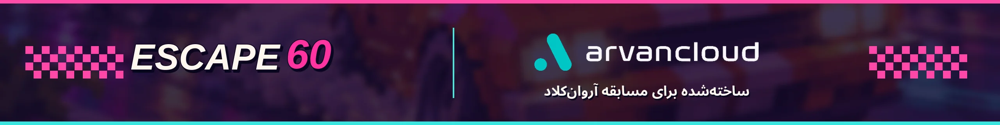
  <br />
  <sub>🌴 An original Sunset Bay escape. Built for the thrill of the chase.</sub>
</div>
