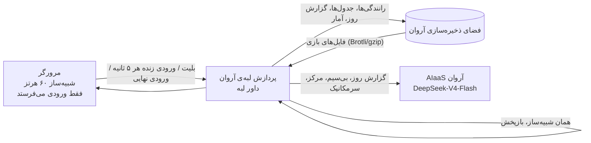

# فرار ۶۰ چطور ساخته شده — پردازش لبه و AIaaS

**[English](TECHNOLOGY.md)** · بازی: https://escape60.lavanai2525-3qem7.arvanedge.ir · داشبورد زنده‌ی لبه: [/edge](https://escape60.lavanai2525-3qem7.arvanedge.ir/edge)

داخل بازی هیچ‌جا اسمی از «لبه» یا «هوش مصنوعی» نیست؛ بازیکن فقط جدول رتبه‌ی منصفانه، رتبه‌ی زنده، رقیب شبح، پیش‌نمایش لینک، گزارش روزانه‌ی شهر با قرارداد، بی‌سیم پلیس و سرمکانیک می‌بیند. این صفحه توضیح می‌دهد پشت هر کدام چیست، کجای کد است و چطور خودتان بررسی‌اش کنید.

## ۱. پردازش لبه — داور لبه
یک Edge Compute (`edge/worker.js`) تنها سرور بازی است: همه‌ی فایل‌ها و کل سرویس بازی (`edge/app.mjs`) را سرو می‌کند. **بدون حالت** است؛ هر چیزی که بین درخواست‌ها لازم دارد داخل بلیت‌ها و نقطه‌های بازبینی امضاشده با HMAC جابه‌جا می‌شود، پس هر گره‌ی لبه به هر درخواستی جواب می‌دهد.

| آنچه بازیکن می‌بیند | کاری که لبه می‌کند | کد |
|---|---|---|
| جدول رتبه‌ی منصفانه | هر رانندگی روی لبه با همان شبیه‌ساز قطعی ۶۰ هرتزی مرورگر دوباره اجرا می‌شود. امتیاز مرورگر فقط مقایسه می‌شود و هر رانندگی یک بار ثبت می‌شود. | `finish()` |
| چیپ **LIVE #12** زیر نقشه | **داور زنده**: هر ۵ ثانیه حدود ۳۰۰ بایت ورودی فرستاده می‌شود و لبه همان ۳۰۰ تیک را بازپخش می‌کند و امتیاز خودش و رتبه‌ی همان لحظه را برمی‌گرداند. نقطه‌های بازبینی به پیشوند دقیق ورودی‌ها (SHA-256) و وضعیت (HMAC) گره خورده‌اند؛ حکم نهایی فقط چند ثانیه‌ی آخر را بازپخش می‌کند. | `live()` |
| تقلب به جدول نمی‌رسد | **اثبات سرعت واقعی**: ورودی نباید سریع‌تر از زمان واقعی برسد — هک سرعت وسط بازی رد می‌شود. امتیاز جعلی، نقطه‌ی بازبینی جعلی، بازنویسی گذشته و ارسال دوباره هم رد می‌شوند (`tests/api.test.mjs`). | `resume()` |
| **رقیب شبح** | ورودی‌های تأییدشده ذخیره می‌شوند؛ لبه رانندگیِ درست بالای رکورد تو را انتخاب می‌کند (یا رانندگی دوستت، یا رکورد خودت) و مرورگر آن را بیت‌به‌بیت به شکل ماشین هولوگرامی بازسازی می‌کند. | `rival()` |
| لینک اشتراک با تصویر | `/r/<id>` صفحه‌ی بازی با تگ‌های Open Graph؛ تصویر پیش‌نمایش یک **PNG پیکسلی است که روی خود لبه کشیده و کدگذاری می‌شود** (انکودر PNG اختصاصی، حدود ۱۹ کیلوبایت). | `edge/card.mjs` |
| «بهتر از ۷۷٪ رانندگی‌های امروز» | هیستوگرام امتیاز هر مسیر | `finish()` |
| بارگذاری سریع روی موبایل | نسخه‌های Brotli/gzip؛ لبه بهترینش را می‌فرستد (حدود ۷۸۰ ← ۱۹۰ کیلوبایت). | `edge/static.mjs` |

داشبورد **`/edge`** (از داخل بازی لینک نشده، برای داوران): آمار زنده‌ی همه‌ی ایزوله‌ها، گزارش امروز، مسیر کار، **آزمایشگاه زنده** که یک ربات رانندگی واقعی می‌کند و شما تقلب می‌کنید و رد شدنش را می‌بینید، و سنجش سرعت گره‌ی لبه.

## ۲. AIaaS — مدیر شهر، بی‌سیم، مرکز و سرمکانیک
مدل: **DeepSeek-V4-Flash** روی AIaaS آروان (`chat/completions` سازگار با OpenAI، هدر `Authorization: apikey …`، استدلال خاموش برای تأخیر کم). کد: `edge/ai.mjs`، اعتبارسنجی و متن‌های جایگزین در `web/src/director.js`، قوانین محدود در `web/src/rules.js`.

| داخل بازی | کار مدل | زمان |
|---|---|---|
| کارت **امروز** در صفحه‌ی اصلی با سه **قرارداد** و جایزه؛ پلیس هر روز رفتار متفاوتی دارد | **مدیر شهر**: موضوع، گزارش، سه قرارداد و تاکتیک‌های پلیس (سرعت داغ شدن، گشت، رهگیرها، راه‌بند، میخ، ترافیک). **این روی گیم‌پلی اثر دارد**: شبیه‌ساز با همین قوانین بازی می‌کند و جایزه می‌دهد. | روزی یک بار، قفل در فضای ذخیره‌سازی، برای همه یکسان |
| **بی‌سیم پلیس** حین تعقیب | بانک جمله‌های بی‌سیم به فارسی و انگلیسی با لحن عملیات همان روز | روزی یک بار برای هر زبان |
| مرکز در پرواز ابتدایی **تو را** اعلام می‌کند | یک تماس برای هر رانندگی از روی ماشین، محله‌ی شروع و رانندگی قبلی‌ات | هر رانندگی (پشت معرفی ۴٫۸ ثانیه‌ای) |
| **سرمکانیک · ری** در صفحه‌ی نتیجه، **هدف بعدی**، تیتر اشتراک و جمله‌ای که شبحت به بقیه می‌گوید | گزارش از روی اعداد بازپخش لبه | بعد از هر رانندگی تأییدشده |

**چرا مدل نمی‌تواند انصاف یا قطعیت را خراب کند:** مدل فقط پیشنهاد می‌دهد؛ نوع قرارداد از لیست مجاز است، همه‌ی هدف‌ها و تاکتیک‌ها در بازه‌های ثابت محدود می‌شوند، جایزه را کد حساب می‌کند، HTML و لینک حذف می‌شود و متن فارسی باید فارسی باشد. قوانین روزانه یک بار قفل می‌شوند، بلیت شناسه‌ی قوانین را امضا می‌کند و لبه هر رانندگی را با همان قوانین بازپخش می‌کند. اگر AIaaS در دسترس نباشد یا سقف روزانه (`AI_DAILY_CAP`) پر شود، متن‌های دست‌نویس دوزبانه جایگزین می‌شوند و بازی بی‌تغییر ادامه دارد.

## ۳. بررسی
صفحه‌ی اصلی: کارت **امروز** (رویش بزنید) · حین بازی: تماس مرکز در معرفی، بی‌سیم پایین صفحه، چیپ **LIVE** و **RIVAL** و ماشین شبح · توقف: پیشرفت قراردادها · نتیجه: رتبه‌ی جهانی و درصد، قراردادها، سرمکانیک، لینک `/r/<id>` · `/edge`: آمار، منبع گزارش امروز (`ai` یا `fallback`)، آزمایشگاه · API: `/api/v1/health`، `/api/v1/challenges/today`، `/api/v1/radio`، `/api/v1/edge`.

اجرای محلی: `npm install && npm test` (۳۱ تست شامل AIaaS با درگاه شبیه‌سازی‌شده و خروجی خراب)، `npm run build && npm run edge:local`. مرجع API: [06_EDGE_SPEC.md](06_EDGE_SPEC.md) · استقرار: [22_DEPLOYMENT.md](22_DEPLOYMENT.md).

**وضعیت (۱۴۰۵/۰۸/۲۸):** همه‌ی موارد بالا پیاده‌سازی و به‌صورت محلی تست شده‌اند (تست‌های Node و مرورگر واقعی روی همان فایل Edge با درگاه AIaaS شبیه‌سازی‌شده). قالب درخواست AIaaS همان است که در نسخه‌ی ۲٫۳ روی آروان زنده تأیید شد؛ پرامپت‌های جدید هنوز روی مدل زنده اجرا نشده‌اند و این نسخه بعد از `npm run deploy` زنده می‌شود.
