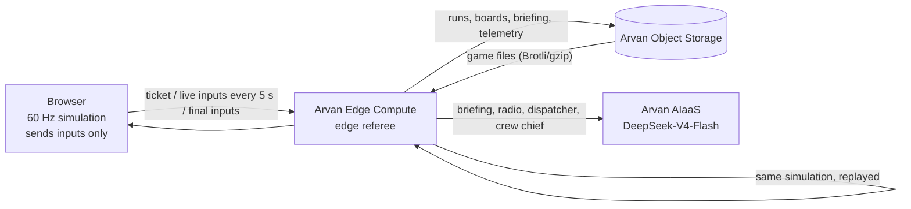

# How ESCAPE 60 is built — Edge Compute and AIaaS

**[فارسی](TECHNOLOGY.fa.md)** · Live game: https://escape60.lavanai2525-3qem7.arvanedge.ir · Live edge dashboard: [/edge](https://escape60.lavanai2525-3qem7.arvanedge.ir/edge)

ESCAPE 60 is a browser street-pursuit racer. In the game, nothing says "edge" or "AI" — players just see a fair global leaderboard, a live rank, ghost rivals, share previews, a daily city briefing with contracts, police radio and a crew chief. This page explains what is behind each of them, where it is in the code, and how to check it yourself.

## 1. Edge Compute — the edge referee
One edge compute (`edge/worker.js`, built to `dist/edge/worker.js`) is the only server. It serves every file of the game and the whole game service (`edge/app.mjs`). It is **stateless**: everything it needs between requests travels in HMAC-signed tickets and checkpoints, so any edge node can answer any request.

| What players see | What the edge does | Code |
|---|---|---|
| A fair leaderboard | Every run is re-simulated on the edge with the same deterministic 60 Hz simulation the browser runs (`web/src/simulation.js`, engine-independent trigonometry in `web/src/dmath.js`). The browser's score is only compared, never trusted. Runs are single-use. | `finish()` in `edge/app.mjs` |
| **LIVE #12** chip under the minimap | **Live referee**: every 5 s the game sends ~300 bytes of inputs; the edge replays those 300 ticks, answers with its own score and the player's rank on today's board right now. Checkpoints are bound to the exact input prefix (SHA-256) and state (HMAC), so the final verdict only replays the last seconds. | `live()`, `resume()` |
| Cheaters do not reach the board | **Pacing proof**: inputs may not arrive faster than real time (+10 %, 3 s jitter) — speed hacks are refused mid-run. Forged scores, forged checkpoints, rewritten history and replayed runs are refused too (see `tests/api.test.mjs`). | `resume()` |
| A **ghost rival** to race | Verified input traces are stored; the edge picks the run just above your best (your friend's run when you open their link, your own best if the board is empty) and sends its inputs. The browser re-simulates them bit-exactly as a holographic car. The next run starts where the ghost started. | `rival()` |
| Share links with a picture | `/r/<id>` returns the game page with Open Graph tags; the preview image is a **pixel-art PNG drawn and encoded on the edge** (own PNG encoder, ~19 KB, a few ms). | `edge/card.mjs`, `edge/png.mjs`, `preview()` |
| "Better than 77 % of today's runs" | Score histogram per route. | `finish()` |
| Fast loading on phones | The build uploads Brotli/gzip copies; the edge negotiates them (game bundle ~780 KB → ~190 KB) and passes byte ranges through for audio. | `edge/static.mjs` |
| — | Telemetry merged from every edge isolate into storage (no personal data) for `/edge`. | `edge/metrics.mjs` |

**`/edge` dashboard** (not linked from the game UI, built for judges): live counters from every isolate, today's briefing, the pipeline, a **Live Lab** where a bot drives a real run while you try to cheat (fake points, speed hack, forged final score) and watch the edge refuse it, and an edge benchmark that steps the simulation on the node that answers you.

## 2. AIaaS — the city director, the radio, the dispatcher and the crew chief
Model: **DeepSeek-V4-Flash** on Arvan AIaaS (OpenAI-compatible `chat/completions`, `Authorization: apikey …`, reasoning disabled for low latency). Code: `edge/ai.mjs` (prompts and calls), `web/src/director.js` (validation and handwritten fallbacks), `web/src/rules.js` (the bounded rules).

| In the game | Model job | When |
|---|---|---|
| Home card **TODAY · <theme>** with three **contracts** and rewards; the police behave differently every day | **City director**: theme, briefing, three contracts (type, goal, district) and the police tactics of the day (heat pace, patrol rate, interceptors, roadblocks, spike strips, traffic). **This changes gameplay**: the simulation plays by these rules and pays the rewards. | Once per UTC day, frozen in storage, identical for everyone |
| **Police radio** lines during the chase (heat, roadblocks, takedowns, pit stops, contracts, busted…) | Radio bank in English and Persian in the voice of the day's operation, with `{zone}` / `{car}` placeholders filled live. | Once per day and language |
| The dispatcher announcing **you** during the aerial intro | One call per run from your car, start district and your previous result today. | Every run (hidden behind the 4.8 s intro) |
| **Crew chief · Ray** on the results screen, a **next target**, a share headline, and the taunt other players hear from your ghost | One report per verified run, written from the edge's own replay numbers (hits, drift, takedowns, contracts done, rank, percentile…). | After each verified run, cached |

**Why the model cannot break fairness or determinism**
- The model only proposes; `sanitizeDirector()` keeps whitelisted contract types, clamps and quantises every goal and tactic to fixed ranges, computes rewards itself, strips markup/URLs, caps lengths and checks that Persian fields are Persian. Hostile output is covered by tests.
- The rules are frozen once per day (first writer wins, `If-None-Match: *`), the ticket signs the rules id, and the edge replays every run with exactly those rules. A run that ignores them does not verify.
- Text the model writes never touches physics or scoring. If the gateway is down, slow or over the daily cap (`AI_DAILY_CAP`), handwritten bilingual content is used and the game is unaffected.

## 3. Object Storage
Private bucket: runs (single-use guard), verified traces (ghosts, cards, previews), leaderboards, score histograms, daily stats, telemetry, the frozen daily briefing and radio bank. Public bucket: the static build. S3 SigV4 is implemented with WebCrypto on the edge (`edge/s3.mjs`).

## 4. How to check it
| Where | What to look for |
|---|---|
| Game home screen | The **TODAY** briefing card (tap it) with three contracts |
| During a run | Dispatcher call in the intro, radio lines at the bottom, the **LIVE #n** chip, the **RIVAL** chip and the cyan ghost car, contract popups |
| Pause | Contract progress |
| Results | Verified global rank + percentile, contracts, crew chief tip and next target; **Share** gives a `/r/<id>` link |
| `/edge` | Telemetry, today's briefing source (`ai` / `fallback`), Live Lab, benchmark |
| API | `GET /api/v1/health` (features, `ai.configured`), `GET /api/v1/challenges/today` (briefing + rules), `GET /api/v1/radio`, `GET /api/v1/edge` |

Local reproduction: `npm install && npm test` (31 tests: determinism, replay, anti-cheat, live referee, ghosts, cards, compression, AIaaS with a mocked gateway including hostile output), `npm run build && npm run edge:local` (the exact edge worker on http://localhost:4174), `npm run test:browser`. API reference: [06_EDGE_SPEC.md](06_EDGE_SPEC.md). Deployment: [22_DEPLOYMENT.md](22_DEPLOYMENT.md).

**Status (2026-11-19):** everything above is implemented and tested locally — Node tests, and a real browser playing against the built edge worker with a local stand-in for the AIaaS gateway. The AIaaS request format is the one verified live on Arvan in v2.3. The new prompts have not yet been run against the live model, and this version is live only after `npm run deploy`.
